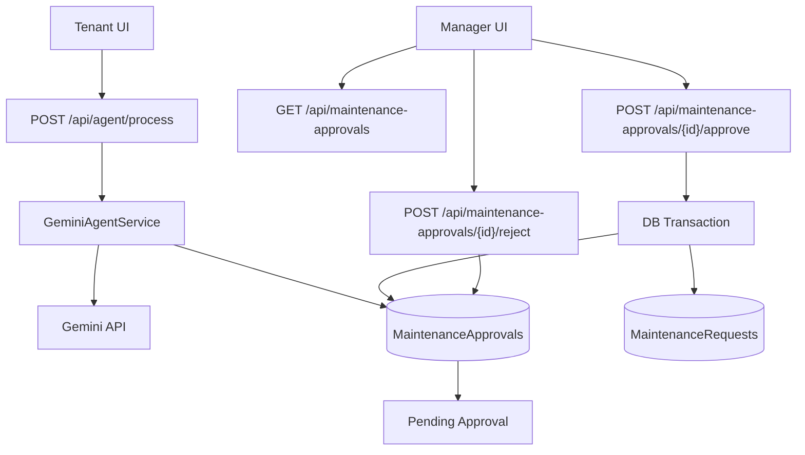

# AI Maintenance Agent

AI Maintenance Agent is a full-stack demo project that explores how to combine LLM-assisted request analysis with explicit human control over execution.

Tenants can describe maintenance issues in plain language. Gemini can classify and structure the issue, but the system stores the result as a Pending approval first. A real maintenance work item is created only after manager approval.

## Problem Statement

Many AI-assisted workflow demos execute actions immediately after model output. In maintenance operations, this can create data integrity and process-control risks.

This project focuses on a safer pattern:

- AI proposes a structured action.
- Backend enforces validation and idempotency.
- Human review gate controls execution.
- Database constraints and transactions protect consistency under retries and concurrency.

## Key Features

- AI-assisted issue analysis through Gemini function-calling style prompts.
- Human-in-the-loop workflow with Pending -> Approved or Rejected transitions.
- Idempotent tenant request processing using idempotency key + request hash.
- PostgreSQL uniqueness constraint on approval idempotency key.
- Concurrency-safe approval processing via conditional updates.
- Transactional creation of MaintenanceRequest during approval.
- Approval list API with filtering, deterministic ordering, and pagination.
- React frontend for tenant submission and manager review.
- Automated backend test suite including concurrency and rollback scenarios.

## Architecture



## End-to-End Workflow

1. Tenant submits issue text with property ID and idempotency key.
2. Backend validates input and property existence.
3. Gemini analysis may produce structured maintenance fields.
4. Backend stores a Pending approval record.
5. Manager reviews Pending items.
6. Approve: create MaintenanceRequest inside a transaction and link it to the approval.
7. Reject: mark approval as Rejected and do not create MaintenanceRequest.

Core rule: AI can prepare data, but only manager approval can create an executable maintenance request.

## Technology Stack

| Layer | Technology |
|---|---|
| Backend API | ASP.NET Core Web API (.NET 10) |
| Data access | Entity Framework Core + Npgsql |
| Database | PostgreSQL |
| AI integration | Gemini API via typed HttpClient |
| Frontend | React + TypeScript + Vite |
| Backend testing | xUnit + WebApplicationFactory + Testcontainers (PostgreSQL) |
| Containers | Docker Compose (local PostgreSQL) |

## Repository Structure

```text
.
|- backend/
|  |- MaintenanceAgent.Api/
|  |- MaintenanceAgent.Api.Tests/
|- frontend/
|- compose.yaml
|- .env.example
|- MaintenanceAgent.slnx
|- README.md
```

Component-specific docs:

- [backend/README.md](backend/README.md)
- [frontend/README.md](frontend/README.md)

## Prerequisites

- .NET SDK 10.x
- Node.js 20+ and npm
- Docker Desktop (or Docker Engine with Compose)

## Local Setup

1. Clone repository

```bash
git clone <REPOSITORY_URL>
cd ai-maintenance-agent
```

2. Configure environment file

```bash
copy .env.example .env
```

3. Set placeholder value in .env

```dotenv
POSTGRES_PASSWORD=<YOUR_LOCAL_POSTGRES_PASSWORD>
```

4. Start PostgreSQL container

```bash
docker compose up -d
```

5. Configure backend secrets (local only)

```bash
dotnet user-secrets init --project backend/MaintenanceAgent.Api
dotnet user-secrets set "ConnectionStrings:MaintenanceDb" "Host=127.0.0.1;Port=5433;Database=maintenance_db;Username=maintenance_user;Password=<YOUR_LOCAL_POSTGRES_PASSWORD>" --project backend/MaintenanceAgent.Api
dotnet user-secrets set "Gemini:ApiKey" "<YOUR_GEMINI_API_KEY>" --project backend/MaintenanceAgent.Api
dotnet user-secrets set "Gemini:Model" "<GEMINI_MODEL_NAME>" --project backend/MaintenanceAgent.Api
```

6. Run backend API

```bash
dotnet run --project backend/MaintenanceAgent.Api
```

Default local URL from launch profile: http://localhost:5247

7. Run frontend

```bash
cd frontend
npm install
npm run dev
```

Frontend dev server proxies /api to http://localhost:5247.

## Environment Configuration

Do not commit secrets.

| Location | Key | Purpose |
|---|---|---|
| .env | POSTGRES_PASSWORD | Compose PostgreSQL container password |
| User Secrets | ConnectionStrings:MaintenanceDb | Backend PostgreSQL connection string |
| User Secrets | Gemini:ApiKey | Gemini API key |
| User Secrets | Gemini:Model | Gemini model name |

## API Endpoint Summary

| Method | Path | Description |
|---|---|---|
| GET | / | Health-style root response |
| POST | /api/agent/process | Analyze tenant issue and create/reuse approval |
| GET | /api/maintenance-approvals/{id} | Get one approval |
| GET | /api/maintenance-approvals | List approvals with optional status, page, pageSize |
| POST | /api/maintenance-approvals/{id}/approve | Approve pending item and create MaintenanceRequest |
| POST | /api/maintenance-approvals/{id}/reject | Reject pending item |
| GET | /api/maintenance-requests | List maintenance requests |
| GET | /api/maintenance-requests/{id} | Get one maintenance request |
| POST | /api/maintenance-requests | Create maintenance request directly |
| GET | /api/properties | List properties |
| GET | /api/properties/{id} | Get one property |
| POST | /api/properties | Create property |

List approvals query contract:

- status: Pending | Approved | Rejected (optional)
- page: >= 1
- pageSize: 1..100

## Automated Testing and Reliability

Backend automated tests run with:

```bash
dotnet test backend/MaintenanceAgent.Api.Tests/MaintenanceAgent.Api.Tests.csproj
```

Coverage focus in current suite:

- Idempotency reuse and conflict behavior.
- Concurrent duplicate agent/process requests with same key.
- Concurrent approval races: approve/approve, approve/reject, reject/reject.
- Transaction rollback when request creation fails.
- Approval list filtering, ordering, pagination, and validation.
- Error-path handling for invalid inputs and Gemini failure scenarios.

Latest observed backend run in this workspace session: 39 passed, 0 failed, 0 skipped.

Note: frontend automated tests and E2E browser automation are not implemented yet.

## Key Design Decisions

- Human approval gate before side-effect creation.
- Idempotency key + request hash to protect retried writes.
- DB unique constraint as final guard against race duplicates.
- Conditional status transitions to enforce single processor semantics.
- Transaction boundary around approval execution to avoid partial updates.
- Real PostgreSQL integration testing via Testcontainers rather than in-memory-only API tests.

## Known Limitations

- No authentication or authorization.
- No CI/CD pipeline documented in this repository.
- No deployment manifests or production hardening guidance.
- Frontend and E2E automated tests are not present yet.
- Current CORS, rate-limiting, and audit trail features are not implemented.

## Future Improvements

- Add frontend unit/integration tests (React Testing Library + Vitest).
- Add E2E tests for the tenant-to-manager workflow.
- Implement API authentication and authorisation (AuthN/AuthZ) to secure API requests, enforce role-based access control (RBAC), and restrict tenant and manager operations to authorised users.
- Add structured audit logging and approval history endpoints.
- Add a CI pipeline to run automated tests and lint checks on pull requests.